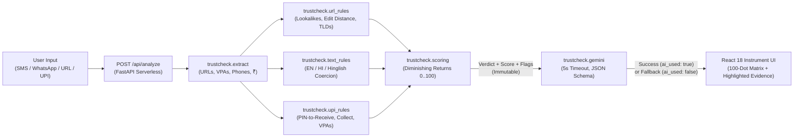

# TrustCheck — See through the scam.

**TrustCheck** is an India-focused scam and phishing detection instrument built for inspecting suspicious SMS alerts, WhatsApp forwards, URLs, and UPI payment requests. It combines a deterministic, unit-tested security rule engine (`/trustcheck`) with a strictly bounded Gemini explanation layer.

---

## 1. The Problem

Digital payments and messaging in India face high-velocity social engineering campaigns:
- **Banking KYC / PAN Phishing**: Lookalike domains (`yonosbi-kyc.top`, `hdfcbankk.com`) paired with 24-hour account freeze threats.
- **UPI Collect & PIN-to-Receive Fraud**: Scammers sending outgoing collect requests (`refund.sbi@ybl`) claiming the victim must enter their 4-digit UPI PIN to *receive* a refund or subsidy.
- **Electricity Disconnection Tonight**: Fake notices from state electricity boards (BESCOM, MSEB, UPPCL, TATA Power) threatening 9:30 PM power cuts unless the user calls an unverified mobile number or installs a `.apk`.
- **Prepaid Task & Fake WFH Jobs**: YouTube like / Telegram VIP tasks demanding upfront "refundable registration fees".
- **Digital Arrest & Customs Seizure Coercion**: Impersonation of CBI, ED, Narcotics Control Bureau, or Customs officials claiming a parcel contains contraband or demanding a video-call "digital arrest".
- **Multi-Lingual Evasion**: Scams frequently mix English, Hindi (Devanagari), and conversational Hinglish (`"Aaj raat bijli kat jayegi"`, `"Paisa paane ke liye UPI PIN daalein"`).

Pure LLM wrappers are prone to prompt injection, latency spikes, and uncalibrated risk scores. Pure regex tools often fail to explain *why* a message is dangerous in plain language.

---

## 2. The Solution: Deterministic First, LLM Second

TrustCheck separates **verdict authority** from **plain-language synthesis**:

1. **Deterministic Extraction & Rule Engine (`/trustcheck`)**:
   - Extracts explicit URLs, bare SMS domains/shortlinks, UPI VPAs, Indian phone numbers, and INR amounts.
   - Evaluates 21 pure, unit-tested rules across `URL`, `Text`, and `UPI` categories with Levenshtein edit-distance checks, homoglyph normalization (`0`→`o`, `1`→`i`), and defensive OTP false-positive guards.
   - Combines signal weights using a diminishing-returns curve capped at `100` (`<30` Safe, `30–64` Suspicious, `>=65` Scam).
2. **Bounded LLM Explanation (`trustcheck/gemini.py`)**:
   - Makes a single call to Gemini (`gemini-3.8-flash`) with a strict 5-second timeout using the deterministic output as context.
   - Returns strict JSON (`scam_type` and a 2–3 sentence `explanation`).
   - **Invariant**: Gemini can **never** alter the deterministic `verdict` or `score`. If `GEMINI_API_KEY` is absent or times out, TrustCheck falls back transparently to deterministic templates (`ai_used: false`).

---

## 3. Architecture Diagram



---

## 4. Repository Structure

```text
├── api/
│   └── index.py                 # Vercel FastAPI serverless entry point (/api/analyze, /api/health)
├── trustcheck/                  # Pure Python detection package
│   ├── __init__.py              # Package exports & analyze_message() pipeline
│   ├── extract.py               # Entity extraction (URLs, VPAs, phone numbers, amounts)
│   ├── url_rules.py             # Brand lookalikes, Levenshtein distance, risky TLDs, shorteners
│   ├── text_rules.py            # English, Hindi (Devanagari), and Hinglish scam rules
│   ├── upi_rules.py             # UPI PIN-to-receive, collect tricks, suspicious VPA handles
│   ├── scoring.py               # Weighted diminishing-returns scorer & fallback templates
│   └── gemini.py                # Single bounded Gemini call (5s timeout, strict JSON)
├── tests/
│   └── test_trustcheck.py       # 32 pytest / unittest cases (Indian scams + safe baselines)
├── src/                         # React + TypeScript + Tailwind CSS frontend
│   ├── components/
│   │   ├── DotMatrixMeter.tsx   # 10x10 (100-dot) sequential risk meter
│   │   ├── HighlightedEvidenceText.tsx
│   │   └── ResultPanel.tsx      # Evidence -> Interpretation -> Verdict display
│   ├── constants/samples.ts     # Interactive test presets
│   ├── types.ts                 # Strict API contracts
│   ├── App.tsx                  # Single-page three-zone instrument interface
│   └── index.css                # Design tokens & reduced-motion rules
├── docs/
│   ├── architecture.md          # Detailed system design & data flow
│   └── detection-rules.md       # Full catalog of all 21 detection rules & rationales
├── DESIGN.md                    # Design system tokens, typography scale & philosophy
├── vercel.json                  # Vercel serverless routing & includeFiles config
├── requirements.txt             # Python production dependencies
└── pyproject.toml               # Poetry, pytest, and ruff configuration
```

---

## 5. Local Setup & Development

### Prerequisites
- **Node.js** `>= 18`
- **Python** `>= 3.11` (compatible with `3.10+`)

### 1. Environment Variables
Copy `.env.example` to `.env`:
```bash
cp .env.example .env
```
Set `GEMINI_API_KEY` if you want AI-synthesized explanations. If omitted, TrustCheck runs in deterministic rules-only mode (`ai_used: false`).

### 2. Install Dependencies
```bash
npm install
pip install -r requirements.txt
# Or with Poetry:
poetry install
```

### 3. Run Development Server
```bash
# Option A: Full-stack dev server (starts Python backend on :8000 and Vite on :3000)
npm run dev

# Option B: Run FastAPI + Vite separately
uvicorn api.index:app --reload --port 8000
npx vite --port 3000
```

---

## 6. Running Tests & Linting

```bash
# Run the 32-case Python test suite via pytest or unittest
pytest
# or
npm run test:py

# Lint Python with Ruff
ruff check .

# Type-check Frontend TypeScript
npm run lint
```

---

## 7. Deployment on Vercel

1. Push the repository to GitHub and import it into **Vercel**.
2. `vercel.json` automatically routes `/api/(.*)` to `/api/index.py` and bundles `trustcheck/**` via `includeFiles`.
3. Add `GEMINI_API_KEY` in **Vercel Project Settings → Environment Variables** (never exposed to the client).
4. Deploy with `vercel --prod`.

---

## 8. Privacy & Security Guarantees

- **Zero Persistence**: Submitted messages are inspected strictly in memory for the duration of the HTTP request and discarded immediately.
- **No Input Logging**: Request handlers suppress payload logging so personal phone numbers, OTPs, or banking alerts never touch disk logs.
- **Server-Side Secrets Only**: `GEMINI_API_KEY` is read exclusively from server environment variables.

---

## 9. Known Limitations

- **Unexpanded Shortlinks**: TrustCheck flags URL shorteners (`bit.ly`, `rb.gy`) as a risk signal without performing active network crawling of the destination URL to avoid tipping off attacker tracking links or introducing SSRF vectors.
- **Image/Audio Scams**: TrustCheck inspects text, URLs, and UPI strings; QR code images or voice call audio must be transcribed to text before analysis.

---

## License

Released under the [MIT License](./LICENSE).
